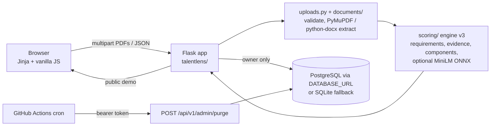

# TalentLens — explainable AI resume ranker

Rank PDF and Word resumes against a job description and see **exactly why** each
candidate scored what they did, with quoted evidence for every requirement. It runs entirely on free tiers.

[](https://github.com/gagan76565/ai-resume-ranker/actions/workflows/ci.yml)
[](LICENSE)

**Live demo:** https://ai-resume-ranker-lowa.onrender.com. The free instance sleeps
when idle, so the first visit can take up to a minute.

> **Similarity is not suitability.** TalentLens compares text. It can miss
> context, only understands English, and must never be the sole basis for a
> hiring decision.

## Screenshots

Placeholders for now. The list of shots to capture is in [docs/TODO_SCREENSHOTS.md](docs/TODO_SCREENSHOTS.md).

| Upload | Results | Why this score? |
| --- | --- | --- |
|  |  |  |

## Features

### Implemented
- **Evidence-based scoring engine v3 (default):** every job requirement gets a verdict taken from the resume itself.
  - The verdicts are *supported*, *unclear*, *inferred (unverified)*, *stated absent* or *not demonstrated*.
  - Each verdict carries an **exact quote**, the section and the page.
  - The fit score blends six components: required-skill evidence, semantic relevance, relevant experience, project relevance, preferred skills and lexical similarity.
  - The weights are configurable. The methodology is in [docs/ai/SCORING_METHODOLOGY.md](docs/ai/SCORING_METHODOLOGY.md).
- **Mandatory vs preferred requirements:** these are detected from the job description wording ("Requirements:", "Nice to have:", "X or Y")
  plus recruiter must-haves. Missing mandatory skills are flagged and reported separately from the score instead of silently capping it.
- **Evaluation confidence** (High/Moderate/Low) is shown separately from fit. It's based on extraction quality, structure and ambiguity, and isn't calibrated.
- **Optional semantic matching:** MiniLM-L6-v2 runs on the CPU through ONNX Runtime, with no PyTorch and no external API.
  It's off unless the model is downloaded (`python scripts/fetch_model.py`). Without it, scoring falls back to lexical-only and says so.
- **Skill intelligence:**
  - 207-skill taxonomy with aliases (`js`, `k8s`, `sklearn` …) and word-boundary-safe matching;
  - 10 top-level groups;
  - related technologies (shown, never counted as equivalent);
  - implications (PostgreSQL ⇒ SQL, marked unverified);
  - negation handling ("no experience with Java").
- **Documents:** PDF via PyMuPDF (page-aware) and Word `.docx`. Quality is graded excellent, partial, poor or needs_ocr.
  Scanned PDFs are **reported, not scored**. OCR is an optional local fallback (Tesseract).
- **Structured profile:** experience entries, education, projects, certifications and contact details. Values are always verbatim; contact details are never used for scoring.
- **Resume improvement suggestions** (`POST /api/v1/resume/analyze`): weak verbs, vague project lines, missing outcomes, generic summaries and gaps.
  Suggestions keep your facts and use `[placeholders]`; nothing is invented.
- **Fairness and safety:**
  - names, contact details and protected-attribute lines are blanked before scoring;
  - resume text that tries to instruct an AI is flagged and ignored;
  - the optional LLM adapter only sees evidence quotes and rejects invented citations.
- **Benchmark:** 72 synthetic, annotated job/resume pairs comparing v2 with v3, with honest limits stated.
  See [docs/ai/AI_BENCHMARK_REPORT.md](docs/ai/AI_BENCHMARK_REPORT.md).
- **Classic engine still available:** `SCORING_ENGINE=v2` gives TF-IDF 40%, skill coverage 45% and section signal 15% ([docs/scoring.md](docs/scoring.md)).
- **Safe uploads:** `.pdf` and `.docx`, checked by magic bytes, 5 MB per file, 20 files, 30 MB total, a DOCX zip-bomb guard,
  and errors that name the file.
- **Public demo that stores nothing,** plus a "Try with sample resumes" button that uses six **synthetic** resumes of fictional people.
- **Owner mode:** sign-in with saved history, search, notes, shortlist, delete with Undo, and CSV export.
- **Results UI:**
  - sortable and filterable table and side-by-side compare;
  - evidence and requirement panels;
  - a skill-gap summary;
  - CSV export of the current view and a print layout;
  - light and dark themes.
- **Privacy:** configurable retention (30 days by default), `flask purge-old`, and an optional GitHub Actions purge cron.
- **API:** versioned `/api/v1` with JSON validation, consistent errors and legacy aliases. `/healthz` and `/readyz` are included. See [docs/api.md](docs/api.md).
- **Database:** PostgreSQL through `DATABASE_URL`, with automatic SQLite fallback and Alembic migrations.
- **Security:** hashed password, CSRF tokens, `HttpOnly`/`SameSite`/`Secure` cookies, a strict CSP, login and screening rate limits,
  constant-time token checks, and text-only rendering of resume content.

### Ideas (not implemented)
- A real LLM provider. Only the interface and a test provider exist.
- Seniority and recency signals, and languages other than English.
- Labels from independent human reviewers on real resumes (to validate weights and confidence).
- Multiple user accounts and teams (see [docs/ai/PERSISTENCE_PROPOSAL.md](docs/ai/PERSISTENCE_PROPOSAL.md)).

## How it works



1. The browser checks each file (extension, size, and the PDF or DOCX signature) before upload.
2. The server checks again, then extracts text page by page with PyMuPDF (PDF) or python-docx (DOCX) in memory, and grades extraction quality. Nothing is written to disk.
3. `scoring/` turns the job description into mandatory, preferred and general requirements, then gives each
   requirement a verdict with quoted evidence from the resume. It combines six components into a fit score,
   reports mandatory coverage and evaluation confidence separately, and optionally adds semantic similarity
   computed on the CPU. Scanned files without text are listed as skipped, never scored.
4. The response contains a ranked list with a full breakdown. Public results stay
   in the browser tab (`sessionStorage`); owner results are saved to the database.

## Tech stack

| Layer | Tools |
| --- | --- |
| Backend | Python 3.10–3.12 (tested; pinned dependencies also resolve on 3.13), Flask 3.1 |
| Scoring | scikit-learn (TF-IDF), a hand-written skills taxonomy and ontology, rule-based evidence engine; optional MiniLM-L6-v2 via ONNX Runtime + tokenizers |
| Documents | PyMuPDF 1.28 (PDF, AGPL-3.0), python-docx 1.2 (DOCX); optional Tesseract OCR locally |
| Database | SQLAlchemy 2 Core, Alembic, PostgreSQL (psycopg2) or SQLite |
| Frontend | Jinja templates, vanilla JavaScript and vanilla CSS design system (no framework, no build step, no CDN); Inter font vendored under `static/vendor/inter` (SIL OFL) |
| Server | Gunicorn (1 worker, 4 threads) |
| Hosting | Render free web service, plus optional free Postgres (Neon or Supabase) |
| CI | GitHub Actions: ruff, and pytest on 3.10/3.11/3.12 plus PostgreSQL |

## Quick start

Requires Python 3.10 or newer. With no configuration, the app runs on SQLite with owner login disabled.

**Windows PowerShell**
```powershell
git clone https://github.com/gagan76565/ai-resume-ranker.git
cd ai-resume-ranker
python -m venv .venv
.\.venv\Scripts\Activate.ps1
pip install -r requirements.txt
python app.py
```

**macOS / Linux**
```bash
git clone https://github.com/gagan76565/ai-resume-ranker.git
cd ai-resume-ranker
python3 -m venv .venv
source .venv/bin/activate
pip install -r requirements.txt
python app.py
```

Open http://127.0.0.1:5000 and press **Try with sample resumes**.

### Enable owner login locally
```bash
cp .env.example .env        # PowerShell: Copy-Item .env.example .env
flask hash-password         # prompts twice; prints a scrypt hash
```
Put `ADMIN_USERNAME`, the printed hash (in single quotes) as `ADMIN_PASSWORD_HASH`,
and a random `SECRET_KEY` into `.env`, then restart `python app.py`.

### Useful commands
| Command | Purpose |
| --- | --- |
| `flask hash-password` | Generate `ADMIN_PASSWORD_HASH` |
| `flask db-upgrade` | Apply migrations (they also run automatically at start-up) |
| `flask purge-old [--days N] [--dry-run]` | Delete saved screenings older than `RETENTION_DAYS` |
| `flask import-sqlite instance/resume_ranker.db` | Import a v1.x SQLite database |
| `python scripts/make_samples.py` | Regenerate the synthetic sample PDFs |

## Configuration

All variables are optional. [.env.example](.env.example) lists them with safe placeholders.

| Variable | Default | Purpose |
| --- | --- | --- |
| `APP_ENV` | `development` (`production` if `RENDER` is set) | Enables `Secure` cookies and HSTS in production |
| `SECRET_KEY` | random per process | Signs session cookies. **Set it in production**, or logins reset on every restart |
| `DATABASE_URL` | empty → SQLite | `postgresql://…` (`postgres://` is accepted too) |
| `DATA_DIR` | `./instance` | Folder for the SQLite file |
| `AUTO_MIGRATE` | `1` | Run Alembic migrations at start-up |
| `ADMIN_USERNAME` | empty | Owner username (login is disabled unless both owner variables are set) |
| `ADMIN_PASSWORD_HASH` | empty | Output of `flask hash-password` |
| `RETENTION_DAYS` | `30` | Saved screenings older than this are deleted |
| `PURGE_TOKEN` | empty (disabled) | Bearer token for `POST /api/v1/admin/purge`; at least 24 characters |
| `SCORE_WEIGHT_TFIDF` | `0.40` | Weight of text similarity |
| `SCORE_WEIGHT_SKILLS` | `0.45` | Weight of skill coverage |
| `SCORE_WEIGHT_SECTIONS` | `0.15` | Weight of section signal |
| `MUST_HAVE_CAP` | `40` | Score cap when a must-have skill is missing |
| `LOW_TEXT_THRESHOLD` | `200` | Below this many extracted characters, a "likely scanned" warning is shown |
| `MAX_FILE_MB` / `MAX_FILES` / `MAX_TOTAL_MB` | `5` / `20` / `30` | Upload limits |
| `MAX_PDF_PAGES` / `MAX_RESUME_CHARS` | `30` / `100000` | Extraction caps |
| `LOGIN_RATE_LIMIT` / `LOGIN_RATE_WINDOW` | `5` / `900` s | Failed logins allowed per IP per window |
| `SCREEN_RATE_LIMIT` / `SCREEN_RATE_WINDOW` | `30` / `600` s | Screening requests per IP per window |
| `TRUST_PROXY` | `0` (`1` if `RENDER` is set) | Number of reverse proxies to trust for client IP |
| `HOST` / `PORT` | `127.0.0.1` (`0.0.0.0` if `RENDER` is set) / `5000` | `python app.py` only; gunicorn binds to `0.0.0.0:$PORT` |
| `SCORING_ENGINE` | `v3` | `v3` (evidence-based) or `v2` (original formula) |
| `V3_WEIGHT_REQUIRED` … `V3_WEIGHT_LEXICAL` | `0.30` `0.25` `0.15` `0.15` `0.10` `0.05` | v3 component weights (required, semantic, experience, projects, preferred, lexical); re-normalised |
| `MANDATORY_POLICY` | `flag` | `flag` reports missing mandatory skills without capping; `cap` applies `MUST_HAVE_CAP` (v2 behaviour) |
| `SEMANTIC_ENABLED` | `auto` | `auto` uses the MiniLM model if `models/all-MiniLM-L6-v2` exists; `0` disables it |
| `SEMANTIC_MODEL_DIR` / `SEMANTIC_THREADS` | `models/all-MiniLM-L6-v2` / `1` | Model location and ONNX threads |
| `SEMANTIC_MAX_SENTENCES` | `700` | Above this per request, semantic matching is skipped for the whole batch |
| `OCR_ENABLED` | `1` | Use Tesseract OCR for scanned PDFs **if** it's installed (local only; `requirements-ocr.txt`) |
| `LLM_PROVIDER` | empty | Optional LLM features; no provider ships (interface only) |
| `TEST_DATABASE_URL` | empty | Run the tests against Postgres |

## Testing

```bash
pip install -r requirements-dev.txt
ruff check .
pytest -q                   # or: python -m unittest
```

Last local run (v2.2.0): **215 tests passed** on SQLite (Windows, Python 3.11, with the semantic model present), on
PostgreSQL 18 (`TEST_DATABASE_URL`) and on Linux (WSL Ubuntu 24.04, Python 3.12, semantic disabled as in CI).
CI repeats this on Python 3.10, 3.11 and 3.12, and against PostgreSQL 16.

The test suite covers:

- **Scoring:** aliases, false-positive guards, weights, empty and short resumes, bias, and determinism, for both v2 and v3.
- **AI engine:** documents (PDF, DOCX, scanned, multi-page, malformed, zip bomb), negation, context strength, requirement
  classes, evidence quotes and pages, confidence, the semantic path (with a fake encoder), fairness, redaction,
  prompt injection, the LLM interface and resume improvement.
- **Uploads:** validation and extraction.
- **Auth and security:** login, rate limiting, CSRF and security headers.
- **API and compatibility:** the v1 API and the legacy routes.
- **Data:** retention, migrations, and the SQLite importer.

Optional browser check (49 checks covering widths of 375, 768, 1024 and 1440 px, keyboard-only use,
compare, CSV, dark mode, history delete and Undo, and console/CSP errors):

AI benchmark (writes `benchmarks/results/latest.{json,md}`):

```bash
python benchmarks/run_benchmark.py
```

```bash
pip install playwright && playwright install chromium
BASE_URL=http://127.0.0.1:5000 OWNER_USER=... OWNER_PASSWORD=... python scripts/ui_check.py
```

### Measured on a local run (not on Render)
Gunicorn ran the Procfile command on WSL Ubuntu 24.04 with Python 3.12 and SQLite, screening 20 two-page PDF resumes per request:

| Engine | Peak worker RSS | 20-file screening | Cold start |
| --- | ---: | ---: | ---: |
| v3, semantic off | 182 MB | 2.5–2.9 s | 2.6 s |
| v3, semantic on | 263 MB | 2.5–3.2 s | 1.0 s |

Render free CPUs are slower, so expect longer times there. Details are in [docs/ai/AI_UPGRADE_PLAN.md](docs/ai/AI_UPGRADE_PLAN.md).

## Deploy on Render (free)

1. **Optional: create a free Postgres database.** Without one, history lives on
   Render's ephemeral disk and is wiped on every deploy or restart.
   - **Neon:** create a project, then copy the connection string (it includes `?sslmode=require`).
   - **Supabase:** go to Project → Connect and use the **Session pooler** URI. The
     direct connection is IPv6-only, which Render does not reach.
2. On Render, create a **New → Web Service** from this repository, or open the existing service.
   - Runtime: Python 3. Build command: `pip install -r requirements.txt`. To enable semantic matching, use
     `pip install -r requirements.txt && python scripts/fetch_model.py` instead. This downloads 23.5 MB, checksum-verified,
     at build time; peak memory was 263 MB in testing.
   - Start command: `gunicorn app:app --workers 1 --threads 4 --timeout 120` (same as the `Procfile`).
   - Health check path: `/healthz`.
   - Instance type: Free.
   - Python version: `.python-version` pins 3.12.
3. Under **Environment**, add:
   - `SECRET_KEY`: a long random value.
   - `DATABASE_URL`: from step 1, optional.
   - `ADMIN_USERNAME` and `ADMIN_PASSWORD_HASH`: run `flask hash-password` locally and paste the output without quotes.
   - Optionally, `RETENTION_DAYS` and `PURGE_TOKEN`.

   Render sets `RENDER=true`, so production mode and the proxy settings switch on automatically.
4. Deploy. Migrations run at start-up. Check `/readyz`, which should return `{"status":"ready"}`.
5. **Optional daily purge:** in GitHub, go to Settings → Secrets → Actions and add
   `TALENTLENS_URL` (your Render URL) and `TALENTLENS_PURGE_TOKEN` (same value as `PURGE_TOKEN`).
   `.github/workflows/retention.yml` then runs daily. The owner history page also purges lazily, at most once an hour.
6. **Optional: keep the service awake.** A free uptime monitor (for example UptimeRobot)
   can ping `/healthz` every 10–14 minutes. One always-on free service fits in Render's 750 free hours a month,
   but it uses them all. When the app is asleep, the UI shows a "waking up" banner and retries API calls automatically.

### Migrating from v1.x
v2 creates new tables (`screenings` and `candidates` with v2 columns) and uses a new
default SQLite file, `instance/talentlens.db`. To keep old history, run
`flask import-sqlite path/to/resume_ranker.db`, with `DATABASE_URL` pointing at the target database.
On Render free, the v1 SQLite file only survives until the next deploy, so it may already be gone.
See [CHANGELOG.md](CHANGELOG.md) for API changes. The most important one is that the history endpoints now need the owner login.

## Limitations and honest notes
- Scores summarise **evidence of skills in the resume text**, not ability, seniority or fit. No accuracy figure on real hiring
  data is claimed. The benchmark is synthetic and its labels were assigned by construction (see the report).
- **English only.** Requirement classes come from wording such as "Requirements:" and "Nice to have:". Unusual job descriptions may be misread.
- A few aliases are ambiguous and context-free. For example, "Express" as an employer name counts as the Express framework.
- Evaluation confidence is a heuristic, not a calibrated probability.
- Scanned PDFs can't be read on Render, because there is no OCR there. They are listed as skipped and never scored.
- Rate limits are kept in memory per process, which suits a single free instance.
- Without `DATABASE_URL`, saved history on Render is wiped on every deploy or restart.
- The public demo sends files to the server for processing. They aren't stored, but only upload resumes you have
  permission to process.

## Project structure

```text
ai-resume-ranker/
├── app.py                    # WSGI entry (gunicorn app:app)
├── talentlens/               # Flask app: config, api, views, auth, security, db, uploads, cli
├── scoring/                  # pure engine: v2 + v3, skills/ontology, evidence, semantic, profile, improve
├── benchmarks/               # synthetic benchmark, v2.0 baseline, results
├── models/                   # optional MiniLM ONNX model (downloaded, not in Git)
├── migrations/               # Alembic environment and versions
├── templates/                # Jinja pages (base, index, results, history, login, error)
├── static/                   # css/app.css, js/*.js, img/favicon.svg
├── samples/                  # synthetic sample resumes + job description
├── scripts/                  # make_samples.py, import_sqlite.py, fetch_model.py, ui_check.py
├── tests/                    # pytest / unittest suite
├── docs/                     # scoring.md, api.md, ai/ (audit, methodology, architecture, benchmark), screenshots TODO
├── .github/workflows/        # ci.yml, retention.yml
├── requirements.txt, requirements-dev.txt, pyproject.toml, alembic.ini, Procfile
└── .env.example, LICENSE, CHANGELOG.md
```

## Roadmap
- Separate "required" and "nice to have" sections in job descriptions.
- Optional per-job custom skills and aliases, editable in the UI.
- Accessibility audit with assistive technology (screen reader pass).
- Optional OCR on a platform that allows system packages.

## License

Copyright © 2026 I. Gagan. Licensed under the [GNU Affero General Public License v3.0 or later](LICENSE) (AGPL-3.0-or-later).

The licence changed from MIT to AGPL-3.0-or-later in v2.2.0 because the PDF extractor, [PyMuPDF](https://pymupdf.readthedocs.io/), is AGPL-licensed. If you run a modified version of TalentLens as a network service, the AGPL requires you to offer its source code to the users of that service. Versions up to and including v2.1.0 remain available under MIT.
