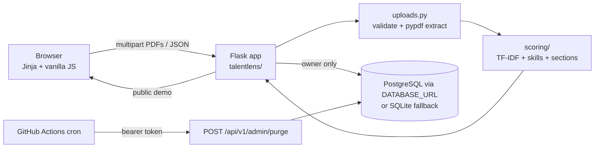

# TalentLens — explainable AI resume ranker

Rank PDF resumes against a job description and see **exactly why** each
candidate scored what they did. It runs entirely on free tiers.

[](https://github.com/gagan76565/ai-resume-ranker/actions/workflows/ci.yml)
[](LICENSE)

**Live demo:** https://ai-resume-ranker-lowa.onrender.com. The free instance sleeps
when idle, so the first visit can take up to a minute.

> **Similarity is not suitability.** TalentLens compares text. It can miss
> context, only understands English, and must never be the sole basis for a
> hiring decision.

## Screenshots

Placeholders for now. The list of shots to capture is in [docs/TODO_SCREENSHOTS.md](docs/TODO_SCREENSHOTS.md).

| Upload | Results | Why this score? |
| --- | --- | --- |
|  |  |  |

## Features

### Implemented
- **Explainable hybrid score (0–100):** TF-IDF similarity (40%), skill coverage
  (45%) and section signal (15%). The weights are configurable, and the
  formula is documented in [docs/scoring.md](docs/scoring.md).
- **Skills taxonomy:** 207 skills with aliases (`js` → JavaScript, `k8s` →
  Kubernetes, `sklearn` → scikit-learn and so on). Matching respects word
  boundaries, so `java` does not match `javascript` and `C++`/`Node.js` work.
- **Must-have skills:** a missing must-have caps the score at 40, shown with a visible badge.
- **Per-candidate breakdown:** components, weights, points, matched and missing skills,
  top shared terms, warnings, and resume excerpts with highlighted matches.
- **Safe uploads:** `.pdf` only, `%PDF` magic-byte check, 5 MB per file, 20 files and
  30 MB total. Errors name the file. Likely-scanned PDFs get a warning instead of a silent 0.
- **Public demo that stores nothing,** plus a "Try with sample resumes" button
  that uses six **synthetic** resumes of fictional people.
- **Owner mode:** sign-in with saved history, search, notes, shortlist, delete with Undo, and CSV export.
- **Results UI:** sortable and filterable table, score bars with number and text label,
  side-by-side compare, a summary of the skills most often missing, CSV export of the current
  view, print layout, and light/dark themes.
- **Privacy:** configurable retention (30 days by default), `flask purge-old`, and an
  optional GitHub Actions purge cron.
- **API:** versioned `/api/v1` with JSON validation, consistent errors and legacy
  aliases. `/healthz` and `/readyz` are included. See [docs/api.md](docs/api.md).
- **Database:** PostgreSQL through `DATABASE_URL`, with automatic SQLite fallback and Alembic migrations.
- **Security:** hashed password, CSRF tokens, `HttpOnly`/`SameSite`/`Secure`
  cookies, a strict CSP, login and screening rate limits, constant-time
  token checks, and text-only rendering of resume content.

### Ideas (not implemented)
- OCR for scanned PDFs. It needs system packages that Render free cannot install.
- Treating "nice to have" or "or" in a job description differently from hard requirements.
- Seniority and recency signals, and languages other than English.
- Multiple user accounts and teams.

## How it works



1. The browser checks each file (extension, size, `%PDF` header) before upload.
2. The server checks again, then extracts text with `pypdf` in memory. Nothing is written to disk.
3. `scoring/` finds the required skills in the job description, plus any must-haves,
   matches them in each resume, detects sections, and computes TF-IDF similarity
   over that pair of documents only.
4. The response contains a ranked list with a full breakdown. Public results stay
   in the browser tab (`sessionStorage`); owner results are saved to the database.

## Tech stack

| Layer | Tools |
| --- | --- |
| Backend | Python 3.10–3.12 (tested; pinned dependencies also resolve on 3.13), Flask 3.1 |
| Scoring | scikit-learn (TF-IDF), a hand-written skills taxonomy and section detector |
| PDF | pypdf 7 |
| Database | SQLAlchemy 2 Core, Alembic, PostgreSQL (psycopg2) or SQLite |
| Frontend | Jinja templates, vanilla JavaScript and vanilla CSS (no framework, no build step, no CDN) |
| Server | Gunicorn (1 worker, 4 threads) |
| Hosting | Render free web service, plus optional free Postgres (Neon or Supabase) |
| CI | GitHub Actions: ruff, and pytest on 3.10/3.11/3.12 plus PostgreSQL |

## Quick start

Requires Python 3.10 or newer. With no configuration, the app runs on SQLite with owner login disabled.

**Windows PowerShell**
```powershell
git clone https://github.com/gagan76565/ai-resume-ranker.git
cd ai-resume-ranker
python -m venv .venv
.\.venv\Scripts\Activate.ps1
pip install -r requirements.txt
python app.py
```

**macOS / Linux**
```bash
git clone https://github.com/gagan76565/ai-resume-ranker.git
cd ai-resume-ranker
python3 -m venv .venv
source .venv/bin/activate
pip install -r requirements.txt
python app.py
```

Open http://127.0.0.1:5000 and press **Try with sample resumes**.

### Enable owner login locally
```bash
cp .env.example .env        # PowerShell: Copy-Item .env.example .env
flask hash-password         # prompts twice; prints a scrypt hash
```
Put `ADMIN_USERNAME`, the printed hash (in single quotes) as `ADMIN_PASSWORD_HASH`,
and a random `SECRET_KEY` into `.env`, then restart `python app.py`.

### Useful commands
| Command | Purpose |
| --- | --- |
| `flask hash-password` | Generate `ADMIN_PASSWORD_HASH` |
| `flask db-upgrade` | Apply migrations (they also run automatically at start-up) |
| `flask purge-old [--days N] [--dry-run]` | Delete saved screenings older than `RETENTION_DAYS` |
| `flask import-sqlite instance/resume_ranker.db` | Import a v1.x SQLite database |
| `python scripts/make_samples.py` | Regenerate the synthetic sample PDFs |

## Configuration

All variables are optional. [.env.example](.env.example) lists them with safe placeholders.

| Variable | Default | Purpose |
| --- | --- | --- |
| `APP_ENV` | `development` (`production` if `RENDER` is set) | Enables `Secure` cookies and HSTS in production |
| `SECRET_KEY` | random per process | Signs session cookies. **Set it in production**, or logins reset on every restart |
| `DATABASE_URL` | empty → SQLite | `postgresql://…` (`postgres://` is accepted too) |
| `DATA_DIR` | `./instance` | Folder for the SQLite file |
| `AUTO_MIGRATE` | `1` | Run Alembic migrations at start-up |
| `ADMIN_USERNAME` | empty | Owner username (login is disabled unless both owner variables are set) |
| `ADMIN_PASSWORD_HASH` | empty | Output of `flask hash-password` |
| `RETENTION_DAYS` | `30` | Saved screenings older than this are deleted |
| `PURGE_TOKEN` | empty (disabled) | Bearer token for `POST /api/v1/admin/purge`; at least 24 characters |
| `SCORE_WEIGHT_TFIDF` | `0.40` | Weight of text similarity |
| `SCORE_WEIGHT_SKILLS` | `0.45` | Weight of skill coverage |
| `SCORE_WEIGHT_SECTIONS` | `0.15` | Weight of section signal |
| `MUST_HAVE_CAP` | `40` | Score cap when a must-have skill is missing |
| `LOW_TEXT_THRESHOLD` | `200` | Below this many extracted characters, a "likely scanned" warning is shown |
| `MAX_FILE_MB` / `MAX_FILES` / `MAX_TOTAL_MB` | `5` / `20` / `30` | Upload limits |
| `MAX_PDF_PAGES` / `MAX_RESUME_CHARS` | `30` / `100000` | Extraction caps |
| `LOGIN_RATE_LIMIT` / `LOGIN_RATE_WINDOW` | `5` / `900` s | Failed logins allowed per IP per window |
| `SCREEN_RATE_LIMIT` / `SCREEN_RATE_WINDOW` | `30` / `600` s | Screening requests per IP per window |
| `TRUST_PROXY` | `0` (`1` if `RENDER` is set) | Number of reverse proxies to trust for client IP |
| `HOST` / `PORT` | `127.0.0.1` / `5000` | Dev server only; gunicorn binds to `0.0.0.0:$PORT` |
| `TEST_DATABASE_URL` | empty | Run the tests against Postgres |

## Testing

```bash
pip install -r requirements-dev.txt
ruff check .
pytest -q                   # or: python -m unittest
```

Last local run: **141 tests passed** on SQLite (Windows, Python 3.11), on
PostgreSQL 18 (`TEST_DATABASE_URL`) and on Linux (WSL Ubuntu 24.04,
Python 3.12). CI repeats this on Python 3.10, 3.11 and 3.12, and against PostgreSQL 16.

The test suite covers:

- **Scoring:** aliases, false-positive guards, weights, empty and short resumes, bias, and determinism.
- **Uploads:** validation and extraction.
- **Auth and security:** login, rate limiting, CSRF and security headers.
- **API and compatibility:** the v1 API and the legacy routes.
- **Data:** retention, migrations, and the SQLite importer.

Optional browser check (41 checks covering widths of 360, 768 and 1280 px, keyboard-only use,
compare, CSV, dark mode, history delete and Undo, and console/CSP errors):

```bash
pip install playwright && playwright install chromium
BASE_URL=http://127.0.0.1:5000 OWNER_USER=... OWNER_PASSWORD=... python scripts/ui_check.py
```

### Measured on a local run (not on Render)
Gunicorn, using the Procfile command, ran on WSL Ubuntu 24.04 with Python 3.12 and SQLite:

- **Cold start:** 1.1–1.7 s to the first `/healthz` response (two runs).
- **Memory:** peak worker RSS was 162.5–162.7 MB and the master was about 27 MB, so about 190 MB in total.
- **Workload:** ranking 20 two-page PDFs took 1.1–1.8 s, and RSS stayed flat over repeated requests.

Render free CPUs are slower, and Render's own wake-up adds time on top of these figures.

## Deploy on Render (free)

1. **Optional: create a free Postgres database.** Without one, history lives on
   Render's ephemeral disk and is wiped on every deploy or restart.
   - **Neon:** create a project, then copy the connection string (it includes `?sslmode=require`).
   - **Supabase:** go to Project → Connect and use the **Session pooler** URI. The
     direct connection is IPv6-only, which Render does not reach.
2. On Render, create a **New → Web Service** from this repository, or open the existing service.
   - Runtime: Python 3. Build command: `pip install -r requirements.txt`.
   - Start command: `gunicorn app:app --workers 1 --threads 4 --timeout 120` (same as the `Procfile`).
   - Health check path: `/healthz`.
   - Instance type: Free.
   - Python version: `.python-version` pins 3.12.
3. Under **Environment**, add:
   - `SECRET_KEY`: a long random value.
   - `DATABASE_URL`: from step 1, optional.
   - `ADMIN_USERNAME` and `ADMIN_PASSWORD_HASH`: run `flask hash-password` locally and paste the output without quotes.
   - Optionally, `RETENTION_DAYS` and `PURGE_TOKEN`.

   Render sets `RENDER=true`, so production mode and the proxy settings switch on automatically.
4. Deploy. Migrations run at start-up. Check `/readyz`, which should return `{"status":"ready"}`.
5. **Optional daily purge:** in GitHub, go to Settings → Secrets → Actions and add
   `TALENTLENS_URL` (your Render URL) and `TALENTLENS_PURGE_TOKEN` (same value as `PURGE_TOKEN`).
   `.github/workflows/retention.yml` then runs daily. The owner history page also purges lazily, at most once an hour.
6. **Optional: keep the service awake.** A free uptime monitor (for example UptimeRobot)
   can ping `/healthz` every 10–14 minutes. One always-on free service fits in Render's 750 free hours a month,
   but it uses them all. When the app is asleep, the UI shows a "waking up" banner and retries API calls automatically.

### Migrating from v1.x
v2 creates new tables (`screenings` and `candidates` with v2 columns) and uses a new
default SQLite file, `instance/talentlens.db`. To keep old history, run
`flask import-sqlite path/to/resume_ranker.db`, with `DATABASE_URL` pointing at the target database.
On Render free, the v1 SQLite file only survives until the next deploy, so it may already be gone.
See [CHANGELOG.md](CHANGELOG.md) for API changes. The most important one is that the history endpoints now need the owner login.

## Limitations and honest notes
- Scores measure **text overlap and skill mentions**, not ability, seniority or fit.
  No accuracy figure is claimed, because the scores were not validated against hiring outcomes.
- **English only.** Negations ("no Java experience") still count as a mention.
- Every skill in the job description counts as required, including "nice to have" ones.
- Some taxonomy aliases are ambiguous: a sentence starting with "Go" counts as the Go language.
- Scanned or image-only PDFs cannot be read, because there is no OCR.
- Rate limits are kept in memory per process, which suits a single free instance.
- Without `DATABASE_URL`, saved history on Render is wiped on every deploy or restart.
- The public demo sends files to the server for processing. It does not store them, but
  only upload resumes you have permission to process.

## Project structure

```text
ai-resume-ranker/
├── app.py                    # WSGI entry (gunicorn app:app)
├── talentlens/               # Flask app: config, api, views, auth, security, db, uploads, cli
├── scoring/                  # pure scoring package + data/skills.json
├── migrations/               # Alembic environment and versions
├── templates/                # Jinja pages (base, index, results, history, login, error)
├── static/                   # css/app.css, js/*.js, img/favicon.svg
├── samples/                  # synthetic sample resumes + job description
├── scripts/                  # make_samples.py, import_sqlite.py, ui_check.py
├── tests/                    # pytest / unittest suite
├── docs/                     # scoring.md, api.md, TODO_SCREENSHOTS.md, REPO_METADATA.md
├── .github/workflows/        # ci.yml, retention.yml
├── requirements.txt, requirements-dev.txt, pyproject.toml, alembic.ini, Procfile
└── .env.example, LICENSE, CHANGELOG.md
```

## Roadmap
- Separate "required" and "nice to have" sections in job descriptions.
- Optional per-job custom skills and aliases, editable in the UI.
- Accessibility audit with assistive technology (screen reader pass).
- Optional OCR on a platform that allows system packages.

## License

[MIT](LICENSE) © 2026 I. Gagan
