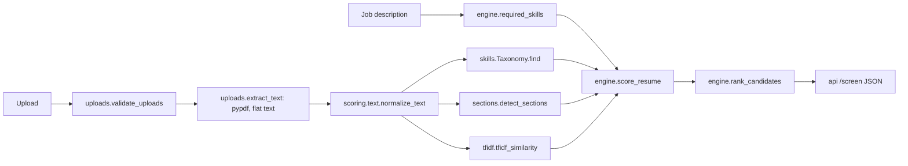
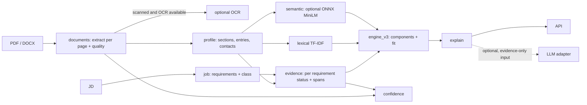

# AI engine architecture

## Current (v2.0)

## Target (v3): an adapted, not a parallel, structure
The brief suggests `app/services/*`. The repository already separates **`scoring/`** (pure,
framework-free engine) from **`talentlens/`** (Flask app). v3 extends these two packages
rather than creating a third tree with duplicate modules:

| Brief's module | Location in this repo | Status |
| --- | --- | --- |
| document_parser | `talentlens/documents/` (`pdf.py`, `docx.py`, `ocr.py`, `quality.py`) | planned (replaces `uploads.extract_text`, which stays as a thin wrapper) |
| text_normalizer | `scoring/text.py` | exists |
| section_detector | `scoring/sections.py` | exists, to be extended (page-aware, more headings) |
| profile extractor (contacts, experience, education, projects) | `scoring/profile.py` | planned |
| skill_ontology / skill_extractor | `scoring/skills.py` + `scoring/data/skills.json` | exists; adds relations, negation, context |
| job_analyzer | `scoring/job.py` | planned (mandatory / preferred / alternatives) |
| lexical_matcher | `scoring/tfidf.py` | exists |
| semantic_matcher | `scoring/semantic.py` | planned, optional backend with lexical fallback |
| experience / project matchers | `scoring/relevance.py` | planned |
| evidence_engine | `scoring/evidence.py` | planned |
| confidence_engine | `scoring/confidence.py` | planned |
| scoring_engine | `scoring/engine.py` (v2) + `scoring/engine_v3.py` | v2 kept intact as the baseline |
| explanation_engine | `scoring/explain.py` | planned |
| resume_improver | `scoring/improve.py` | planned (deterministic rules) |
| LLM adapter | `talentlens/llm/` | planned, off by default |

## Runtime principles
* **The engine is selectable**: `SCORING_ENGINE=v2|v3`. v2 stays available for regression and comparison.
* **Models load once per process** (lazy singleton) and **embeddings are cached per text hash** in an LRU within the
  process. Nothing about resumes is persisted.
* **Graceful degradation**: model missing, failing or too slow → the lexical engine is used, the semantic weight is
  redistributed, and the candidate shows "semantic matching unavailable". The OCR binary missing → scanned PDFs are flagged as unreadable, not scored as valid.
* **No external calls** in the core path. The LLM is opt-in, receives only the evidence the deterministic pipeline found, and its output is
  schema-validated.

## Computational estimates (to be replaced by measurements in AI_BENCHMARK_REPORT.md)
| Item | Estimate | Basis |
| --- | --- | --- |
| Current worker RSS | 162.5–162.7 MB | **measured** (WSL, gunicorn, 20 PDFs) |
| onnxruntime + tokenizers in memory | +60–120 MB | estimate; to measure |
| MiniLM-L6-v2 ONNX model file | ~90 MB fp32, ~23 MB int8 | published model sizes; to verify |
| Embedding throughput, CPU | hundreds of short sentences per second on a laptop CPU; much slower on Render's shared vCPU | estimate; to measure |
| torch + sentence-transformers | well over 512 MB RSS | why it's excluded from the Render deploy path |
