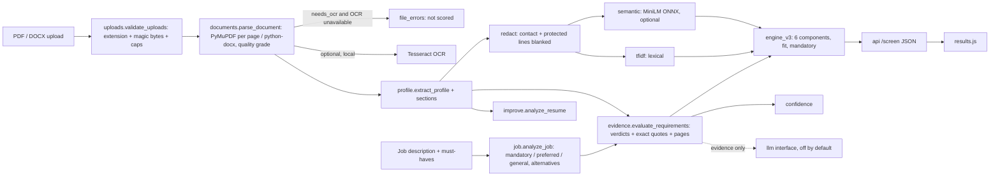

# AI engine architecture (v2.2.0)

## Modules (the brief's names mapped to this repository)
| Brief | Implemented in |
| --- | --- |
| document_parser | `talentlens/documents/` (`parsers.py`, `quality.py`, `ocr.py`, `model.py`) |
| text_normalizer | `scoring/text.py` |
| section_detector | `scoring/sections.py` (adds finer `label`s and `section_at`) |
| skill_ontology / skill_extractor | `scoring/skills.py`, `scoring/ontology.py`, `scoring/data/{skills,relations}.json`, `scoring/context.py` |
| job_analyzer | `scoring/job.py` |
| lexical_matcher | `scoring/tfidf.py` |
| semantic_matcher | `scoring/semantic.py` (+ `scripts/fetch_model.py`) |
| experience / project matchers | inside `scoring/engine_v3.py` (located evidence) |
| evidence_engine + explanation_engine | `scoring/evidence.py` (verdict explanations), `talentlens/screening.py::explanation_v3` |
| confidence_engine | `scoring/confidence.py` |
| scoring_engine | `scoring/engine_v3.py` (v3) and `scoring/engine.py` (v2, unchanged) |
| profile extraction | `scoring/profile.py` |
| resume_improver | `scoring/improve.py`, endpoint `POST /api/v1/resume/analyze` |
| LLM adapter | `talentlens/llm.py` (interface + fake provider) |
| safety | `scoring/redact.py` (offset-preserving redaction, prompt-injection detection) |

`scoring/` is still framework-free, so it can run from scripts and the benchmark. `talentlens/` is the Flask app.

## Runtime behaviour
* The engine is chosen with `SCORING_ENGINE` (`v3` by default, or `v2`).
* The MiniLM model loads lazily **once per process**. Embeddings are kept in a bounded in-memory LRU cache. A missing model, `SEMANTIC_ENABLED=0`
  or a load error means lexical-only scoring, and the response says so.
* No external network calls happen during screening. The model download is a separate build-time step.
* Measured footprint: see `AI_UPGRADE_PLAN.md`, Performance (182 MB lexical, 263 MB with the model, 20 PDFs in about 2.5–3 s on Linux).
